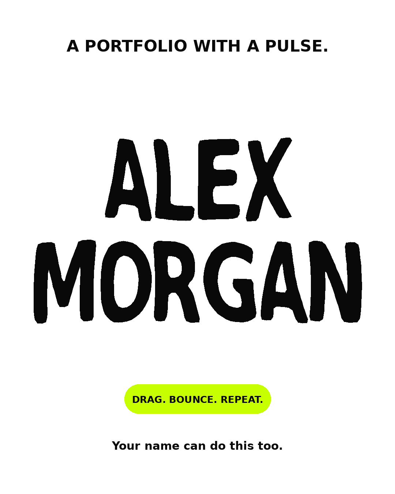

# Elastic Portfolio

**Your name. A little less well behaved.**

A free, dependency-free portfolio template by [Moushette Maquilon](https://www.moushettemaquilon.com/). Drag, bounce and stretch the letters in your name. Scroll into a descending project menu. Let a talking cut-out head send your links flying.

Built while refreshing my own portfolio, then packaged so you can make it yours.



## What you get

- Contour-based elastic letter physics, pointer dragging and keyboard controls.
- A two-line name opening that adapts to your own letters.
- Descending category menu and individual scrolling project galleries.
- A cut-out puppet head with a moving chin and links that fly from its mouth.
- Biography, expandable questions, email link and responsive layouts.
- Reduced-motion support and original SVG placeholders. No tracking, paid fonts, API keys or dependencies.

[See the original portfolio](https://www.moushettemaquilon.com/) · [Watch the sample feature demo](demo.mp4)

The video is a rendered feature demo using the same letter physics and cut-out composition, rather than a screen recording. `index.html` is the actual interactive demo.

## Try it

Download the repository ZIP and open `index.html` in a browser. The checked-in file works without a build or server.

To edit the source, install Node.js 18 or newer, then:

```sh
npm run build
npm test
npm start
```

Open http://localhost:8080. There is no `npm install` step. If you do not have Python, use any static local server or open `index.html` directly.

## Make it yours

1. Edit **`portfolio-content.js`**: your two name lines, page title, description, category titles, projects, biography, email and external links. The sample person and projects are fictional.
2. Add your images next to **`index.html`**, update each `src`, `alt`, `width` and `height`, and remove unused sample graphics.
3. Change `--paper`, `--ink` and `--lime` at the top of **`portfolio.template.html`** for your colours.
4. Run `npm run build`, then preview `index.html`.

Keep `approved: true` on projects and `permission: "approved"` on images you want displayed. These are editorial display switches, not a rights-management system. Publish only material you have permission to use.

### Your elastic name

```js
identity: {
  displayName: 'Your Name',
  nameLines: ['YOUR', 'NAME'],
  title: 'Your Name | Portfolio',
  description: 'What you do, in one sentence.'
}
```

Use two non-empty lines. Shorter names are larger; long names shrink to fit. Spaces are removed from the animated lettering; your accessible display name keeps them. Letters are traced from your browser's local heavy system font. Very long names and complex scripts need visual testing.

Drag a letter, click it to nudge, or focus with Tab and use arrow keys. Shift increases the nudge; Escape resets the letters.

### Your talking head

See **[the cut-out guide](cut-out-head.md)**. The sample is an original illustration, not a photograph. Replace it with your own transparent cut-out, aligned to the supplied guide, to keep the chin and link animation working.

Hover opens links on a mouse device. Tap or press Enter/Space toggles them. Links remain available after the animation finishes. Reduced motion shows the links without the flight animation.

## Publish

Upload the repository files together to any static host. All asset paths are relative, so a repository subdirectory works too.

For GitHub Pages: push this template to your own repository, open Settings → Pages, and publish from the `main` branch root. Host setup and availability depend on your account. This is a standalone template; it does not require Squarespace. Customising an existing hosted site needs its own integration.

## Files

| File | Purpose |
| --- | --- |
| `portfolio-content.js` | Name, work, biography and links |
| `portfolio.template.html` | Layout, styling and interaction |
| `soft-letters.js` | Elastic physics and contour tracing |
| `build.cjs` | Builds a static site with inline JavaScript |
| `index.html` | Ready-to-open built page |
| `project-*.svg`, `head-placeholder.svg`, `portrait-placeholder.svg` | Original sample graphics |

## License and photography

MIT licensed. Free to use and adapt, including commercially. Keep the license notice in your source distribution; an on-page credit is appreciated, not required.

**No photographs, portraits, client work or project imagery from Moushette’s portfolio are included or licensed here.** The original portfolio is linked solely as an example. This repository starts with its own clean history and contains only source, original placeholders and a demo of those placeholders.

## Validation and limits

Run `npm test` for source parsing, content and local asset checks. `npm run check:release` additionally verifies that this original release has only placeholder SVGs and sample contact details; it is not intended to pass after you add your own photographs. The physics, gallery entry, head toggle and reduced-motion behavior are checked with a simulated DOM; these are not full browser or device tests. Browser review of the public template remains pending. Physical device behavior and performance vary with font, image size and browser; test your own material before sharing.
